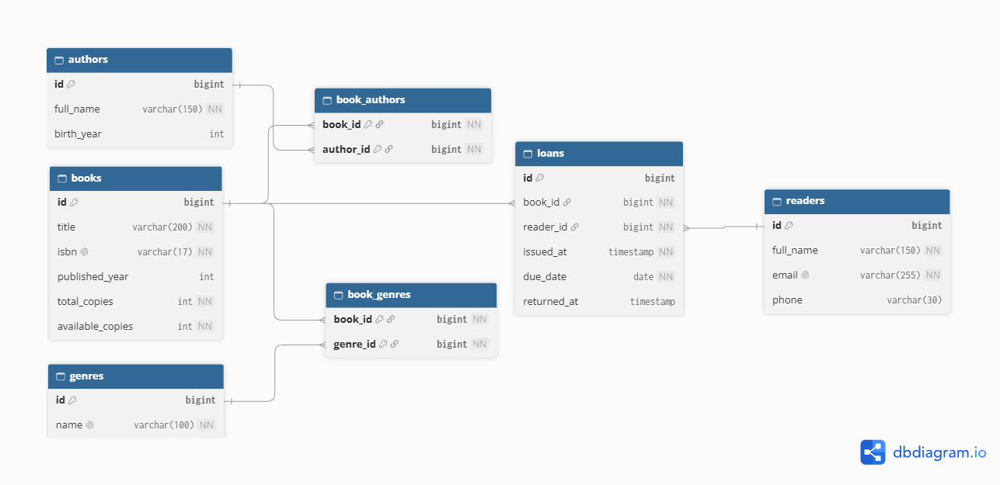

# BookShelf

BookShelf — REST API для управления библиотекой.

Проект разработан в рамках курса MegaLab,
урок 73.

## Технологии

- Java 21
- Spring Boot
- Spring Web
- Spring Data JPA
- PostgreSQL
- Hibernate
- Jakarta Validation
- Maven

## Реализованные возможности

### Книги (Book)

- Создание книги
- Получение списка книг
- Получение книги по ID
- Обновление книги
- Удаление книги
- Проверка уникальности ISBN
- Контроль количества экземпляров

### Авторы (Author)

- Создание автора
- Получение списка авторов
- Получение автора по ID
- Обновление автора
- Удаление автора

## REST API

### Books

| Метод | Endpoint | Описание |
|---|---|---|
| POST | /api/v1/books | Создать книгу |
| GET | /api/v1/books | Получить все книги |
| GET | /api/v1/books/{id} | Получить книгу |
| PUT | /api/v1/books/{id} | Обновить книгу |
| DELETE | /api/v1/books/{id} | Удалить книгу |

### Authors

| Метод | Endpoint | Описание |
|---|---|---|
| POST | /api/v1/authors | Создать автора |
| GET | /api/v1/authors | Получить всех авторов |
| GET | /api/v1/authors/{id} | Получить автора |
| PUT | /api/v1/authors/{id} | Обновить автора |
| DELETE | /api/v1/authors/{id} | Удалить автора |

## HTTP-статусы

- 200 OK — успешное получение или обновление
- 201 Created — создание записи
- 204 No Content — удаление записи
- 400 Bad Request — ошибка валидации
- 404 Not Found — запись не найдена
- 409 Conflict — нарушение бизнес-правила

## База данных

Используется PostgreSQL.

Название локальной базы данных: bookshelf.

Основные сущности проекта:

- Book
- Author
- Genre
- Reader
- Loan

На текущем этапе реализованы Book и Author.
Остальные сущности и связи будут добавляться
на следующих этапах.

## Запуск приложения

1. Создать базу данных bookshelf в PostgreSQL.
2. Настроить переменные окружения DB_URL,
   DB_USER и DB_PASSWORD.
3. Запустить BookShelfApplication.
4. API будет доступно по адресу:
   http://localhost:8080

## ER-диаграмма

